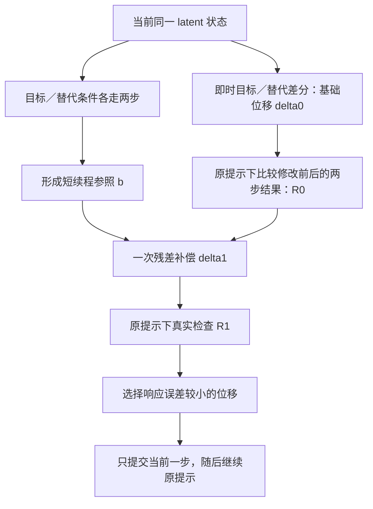

# SCRM：短续程响应匹配的速度擦除

日期：2026-10-27。本文是可实现、可证伪的研究设计，没有真实模型效果结论。

## 1. 想解决的具体问题

在状态 `z` 上，加上安全条件与目标条件的 velocity 差，可以改变当前采样更新。下一步 DiT 会在修改后的状态上、继续按原用户提示重新预测。后续计算可能放大、削弱或旋转刚才的修改。

这不自动表示“模型恢复了目标概念”：正常生成也会改变扰动方向。真正值得测试的是，**能否根据实际短续程响应，找到比即时差分更合适的第一次修改，并改善最终擦除与保留。**

主方案不假设生成轨迹严格笔直，不假设某个内部方向只编码目标，也不构造目标概念概率。



## 2. 只需要哪些接口

输入是原用户提示 `p`、待擦除概念描述 `f`、替代描述 `a`、冻结的生成模型和固定采样时间表。

例如身份／角色匿名化可用 `a picture of Snoopy` 与 `a picture of a generic cartoon dog`。若擦除任务是整个“狗”类别，普通狗不再是有效替代。初版使用人工固定的背景匹配描述，不接 LLM 改写，也不依赖用户提示显式含有目标词。

记 `V_c(z,t)` 为**管线最终交给 sampler 的生成速度**。它包含该模型原生的 conditioning 与 guidance，所有分支使用相同配置。第一版只处理普通 velocity-prediction flow 模型。

统一用生成方向的时间 `t`：从噪声走向数据，两个真实 Euler 步长为 `h0>0`、`h1>0`。模型内部的 timestep 可以递减，适配层负责把输出与实际积分坐标对齐。对 sigma 递减的 rectified flow，可取 `t=1-sigma`，相应转换速度符号；不能把移位后的网络 timestep 当作线性噪声系数。

主算法只调用 `V` 和 Euler 更新，不读取内部 block。latent 的 packing/unpacking 由模型适配层处理；向量范数在单张样本的全部 latent 维度上计算。

## 3. 起点沿用已有差分，避免混淆贡献

在相同 `(z,t)` 上计算用户、目标和替代三个速度，得到 `d=V_a-V_f`。基础速度修正写为 `q0=lambda*d`。

第一版沿用已复现 DVE 的投影门控与强度，使新旧方法共享相同触发条件。若用其常见写法，`e=d/||d||`、`s=<V_p,e>`，则 `lambda=gamma*[tau-s]_+/||d||`。很小的差分直接跳过，数值处理与基线一致。

也可以以固定正 `lambda` 做机制消融，但不能把门控变化与续程校正的收益合并报告。

当前步的基础**状态位移**为 `delta0=h0*q0`。后文反求的是状态位移，最后再除以 `h0` 转回输出速度。这样不会混淆不同采样步长。

门控未触发时直接按原模型走一步；本方案不会因此修复 DVE 的漏触发。目标／替代描述与门控质量仍是继承的限制。

## 4. 三个核心计算

### 4.1 用两步条件生成形成参照

分别从同一个 `z` 出发，让目标和替代条件各走两步：

\[
F_c(z)=z+h_0V_c(z,t)
       +h_1V_c(z+h_0V_c(z,t),t+h_0),\quad c\in\{a,f\}.
\tag{1}
\]

定义希望这次单步脉冲在两步之后产生的位移参照：

\[
b=\lambda\frac{h_0}{h_0+h_1}\,[F_a(z)-F_f(z)].
\tag{2}
\]

这里的系数把两步累计差异按实际时间跨度缩放到一次脉冲的量级。它是明确的设计选择，不是由概率最优性推导出的唯一系数；非均匀步长时仍使用真实 `h0/(h0+h1)`。

当条件速度在这段内不变化时，式（2）恰好等于 `delta0`。真实模型里，两条分支会访问不同状态，这正是相较即时差分增加的短续程信息。

`b` 是同一模型给出的**局部编辑参照**，不是无目标终点或安全标签。它仍包含 anchor 偏差，也可能受分支构图变化影响。不能因为用了两步，就把它称为更正确的语义真值。

### 4.2 测量原用户提示下的实际响应

令 `x=z+h0*V_p(z,t)`，在当前更新中额外施加状态位移 `delta` 后，下一步始终使用原用户提示：

\[
G_p(\delta)=x+\delta+h_1V_p(x+\delta,t+h_0),\qquad
R(\delta)=G_p(\delta)-G_p(0).
\tag{3}
\]

计算 `R0=R(delta0)`。它是修改前后两个真实程序输出之差，不是另一个训练出的响应模型。

`R0-delta0` 记录后续重新预测造成的变化。应先称它为“续程响应偏差”；只有独立的完整图像续程实验支持时，才能把其中一部分解释为概念恢复。

### 4.3 一次残差补偿，再做真实检查

只做一次修改：

\[
r=b-R_0,\qquad
\delta_1=\delta_0+
r\min\left(1,\frac{\|\delta_0\|}{\|r\|}\right).
\tag{4}
\]

零残差对应零增量。式（4）把补偿增量限制在原始位移范数内，因此 `||delta1||≤2||delta0||`。**这里限制的是增量，不是把最终位移强行裁剪回原范数。** 后者会阻止最常见的平行收缩补偿。

再真实计算一次 `R1=R(delta1)`。若 `||R1-b||² < ||R0-b||²`，采用 `delta1`；否则采用 `delta0`。不迭代、不继续搜索，不引入额外语义判别器。这个接受规则只保证两候选中所选者的当前响应拟合误差不更大，不保证图像擦除效果更好。

最终交给当前 Euler 步的速度为 `V_p+delta_selected/h0`。只提交当前一步，下一步仍使用原提示和原采样流程。

## 5. 为什么一次残差修正可能有效，也可能失败

式（4）将终点响应残差直接加回初始状态位移，隐含一个局部近似：在短区间里，`delta` 到 `R(delta)` 的变化接近恒等映射。可理解为对短程逆响应的一次 defect correction；这是通用数值思想，不是新的数学工具。

不求完整 Jacobian，不训练逆映射。局部近似不成立时，真实复查会拒绝这一次补偿，但不能解决 `b` 本身不合适的问题。

一个可手算的例子：假设局部响应为 `R(dx,dy)=(dx,dx+dy)`，参照 `b=(1,0)`，基础位移 `delta0=(1,0)`。基础响应为 `(1,1)`；残差为 `(0,-1)`；补偿后位移为 `(1,-1)`，真实响应恰好为 `(1,0)`。

只沿原方向乘任意标量，最小响应误差为 `sqrt(1/2)`，无法达到零。这个例子只说明**补偿可以超出调强度**，没有代表真实 DiT。相反，若真实响应仅为平行收缩，标量调节就足够，新方向没有必要。

还有一个重要失败例：模型后续旋转了位移，而这种旋转正是生成正确安全内容所必需的过程。将其校正回来可能降低图像质量。因此最终判据必须落到图像擦除和保留，不能停在响应 L2。

## 6. 概念流程

```text
预先固定概念/替代描述、基础门控参数、两个检查位置
缓存模型自身文本编码器的条件输出

for 每个原生 Euler 步:
    得到当前用户生成速度 vp（可能来自已验证缓存）
    若不是检查位置，或已没有完整两步区间:
        正常采样
        continue

    得到同状态 va、vf；沿用基础门控形成 q0
    若 q0 为零:
        正常采样
        continue

    delta0 = h0 * q0
    各自续程一步，得到两步端点 Fa、Ff
    b = lambda * h0/(h0+h1) * (Fa-Ff)

    在用户无修改的下一状态预测，得到 Gp(0)
    在基础候选下一状态预测，得到 R0
    delta1 = delta0 + 限幅(b-R0)
    在补偿候选下一状态预测，得到 R1

    采用实际响应误差较小的 delta0 或 delta1
    只提交当前 Euler 更新
    可缓存所选下一状态下已算出的用户速度
```

两个检查位置至少间隔一个正常步，方便解释脉冲响应并复用缓存。第一版不开启逐步自适应位置搜索，也不把离线挑选位置称为创新。

## 7. CFG 与原生 guidance 的正确接入

**真实两分支 CFG：** `V_c=V_empty+g*(V_cond,c-V_empty)`。`F_a`、`F_f`、`G_p` 的每个调用都完整遵守这个定义。式（4）的修改直接作用于最终组合后的速度，不能再乘一次 CFG 系数。

当前相同状态的用户、目标、替代分支可共享无条件输出。下一步它们已在不同状态，必须各算其无条件输出，不能继续共享。

**原生 guidance embedding：** 使用模型原有单分支条件接口，在所有查询中固定相同 guidance 设置。不为 FLUX.1-dev 凭空构造无条件分支，也不把 guidance embedding 的标量等同于外部 CFG 系数。

首版只支持确定性、无历史状态的 Euler。多步 solver 的历史、stochastic noise、guidance rescale 都需要按真实程序扩展响应定义；不能沿用本文调用数直接声称已经适配。MeanFlow／consistency 类区间预测同样另行处理。

## 8. 成本与准备量

单分支每个触发的完整检查点，已有当前用户速度之外，需要：

| 查询 | 额外样本前向 |
|---|---:|
| 当前状态的目标、替代速度 | 2 |
| 两条概念分支各自的下一步速度 | 2 |
| 用户无修改下一状态速度 | 1 |
| 基础候选下一状态速度 | 1 |
| 补偿候选下一状态速度 | 1 |
| 合计 | 7 |

所选候选的下一状态速度已算出，若下一步是正常步，缓存可替代它的一次原生调用，净增加六次。检查点不会连续；配置、状态或条件变化时不能错误复用缓存。

以 `T=28`、两个完整触发点为例：保守计数 `28+14=42`；正确复用时 `28+12=40`。这是**样本前向数量推算**，不是实测延迟。门控不触发仍花费当前目标／替代两次查询；报告实际触发率和总调用数。

真实 CFG 若仅共享当前状态的无条件分支，一个完整点额外 `2+2*5=12` 次底层样本前向；复用所选下一步完整 CFG 后净增十次。因此同例是 `56+24=80` 或复用后的 `56+20=76`。批量并行不会减少样本计数，可能改变延迟和峰值显存。

准备只包括少量人工概念／替代描述、原生条件缓存，以及小开发集上的基础强度和两个位置选择。没有概念专属网络、方向字典训练或每张图的反向传播。开发集生成开销需要计入，不能写成零准备。

## 9. 当前最重要的边界

- 短续程条件差能否表达当前用户场景需要的编辑，尚待验证。
- 实际响应可能高度非线性或与语义无关；一次补偿未必值得它的成本。
- 原 gate 漏检、anchor 携带偏差、多个概念共存、长提示上下文失配，仍会影响方法。
- 部署移除插件后原模型能力恢复；它属于推理期概念抑制，不是已证明的永久参数遗忘。
- 在不同模型上重新验证时间和 guidance 接口；这里的接口通用性不等于缓存、阈值或概念描述可以直接跨模型复用。

论文贡献应由[实验设计](EXPERIMENTS.zh-CN.md)中的同预算方向／强度对照和完整续程验证来决定。
