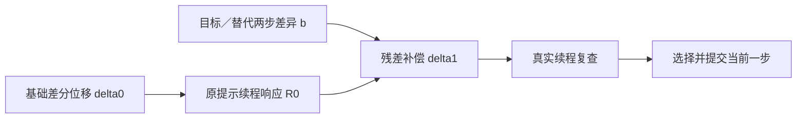

# SCRM：核心方法与整体流程

更新：2026-10-29。

状态：**已因在线前向过多及多概念扩展成本被用户否决，停止推进。** 以下保留原方案讲解。

SCRM 在采样中的少数位置，先构造基础擦除修正，再测量这次修正经过原提示下一步计算后的实际效果，最后补偿它与短续程参照之间的偏差。

方法围绕三个量展开：**初始位移 `delta0`、两步参照 `b`、实际响应 `R(delta0)`**。

## 1. 输入与接入位置

输入包括原用户提示 `p`、目标概念描述 `f` 和替代描述 `a`。例如擦除 Snoopy 身份时，`f` 描述 Snoopy，`a` 描述普通卡通狗；用户提示 `p` 保留原有场景与对象关系。

记 `v_c(z,t)` 为原生成管线在条件 `c` 下交给采样器的速度，包含原生 guidance。时间沿噪声到图像递增，当前和下一步的 Euler 步长分别为 `h0`、`h1`。模型参数全程冻结。

## 2. 构造基础擦除位移

在同一个状态 `z`、同一个时刻 `t`，计算目标与替代条件的速度差：

\[
q_0=\lambda\,[v_a(z,t)-v_f(z,t)],\qquad
\delta_0=h_0q_0.
\]

`q0` 是速度修正，`delta0` 是它在当前步造成的 latent 位移。`lambda` 沿用基础差分擦除的门控与强度；未触发时直接正常采样。

## 3. 建立两步编辑参照

从同一状态 `z` 出发，分别在目标和替代条件下走两个正常 Euler 步：

\[
z_c=z+h_0v_c(z,t),\qquad
F_c=z_c+h_1v_c(z_c,t+h_0),\quad c\in\{a,f\}.
\]

用两个端点的差形成参照：

\[
b=\lambda\frac{h_0}{h_0+h_1}(F_a-F_f).
\]

`Fa-Ff` 描述目标／替代条件在两步生成中造成的累计差异；时间比例把它缩放到一次当前步干预的量级。两步等长时，比例为 `1/2`。

`b` 为下一步之后的编辑效果提供参照。若这段内两个条件的速度各自保持不变，便有 `b=delta0`；真实续程则将两条条件轨迹的变化纳入参照。

## 4. 测量原提示下的实际响应

先得到原提示的正常下一状态 `x=z+h0*v_p(z,t)`。然后比较两条临时路径：一条从 `x` 继续一步，另一条从 `x+delta` 继续一步。两条路径都使用原提示 `p`，第二步都正常采样。

两步结束时的状态差为：

\[
R(\delta)=\delta+h_1\left[
v_p(x+\delta,t+h_0)-v_p(x,t+h_0)
\right].
\]

第一项是直接施加的位移，第二项是原提示重新预测速度后产生的额外变化。计算 `R0=R(delta0)`，便得到基础修正经过后续计算的实际效果。

## 5. 补偿偏差并复查

用参照与实际响应之差修正初始位移：

\[
r=b-R_0,\qquad
\delta_1=\delta_0+operatorname{clip}_{\|\delta_0\|}(r).
\]

`clip` 保持 `r` 的方向，将其范数限制在 `||delta0||` 内。补偿可以改变擦除位移的方向和幅度，总位移范数不超过原来的两倍。

这一步把终点偏差直接加回初始位移，采用短程响应局部接近恒等映射的近似。随后真实计算 `R1=R(delta1)`，检查修正是否有效：若 `||R1-b||²` 更小，选 `delta1`；否则选 `delta0`。

例如参照是 `(1,0)`，基础响应是 `(1,0.4)`，则残差为 `(0,-0.4)`。方法把这部分作为补偿增量，再运行一次原提示续程检查结果。

## 6. 提交当前一步并继续生成

选定 `delta*` 后，实际更新为：

\[
z_{\rm next}=z+h_0v_p(z,t)+\delta_*.
\]

等价的输出速度是 `v_p+delta*/h0`。临时分支用于计算参照和响应，最终只提交这一个当前步。下一步按原提示正常生成，直到下一个检查位置。

首版设置两个不相邻检查点，其余步骤正常采样。所选下一状态的原提示速度已在复查中算出，可以供下一步复用。

方法通过冻结 DiT 的条件速度输出完成全部计算，适配重点是时间、latent 格式和原生 guidance。单分支每个完整触发点增加七次前向，复用下一步速度后净增六次；28 步、两个完整触发点对应 40 次样本前向。

在线选择依据是两步响应拟合误差。最终图像的擦除与保留收益，以及完整向量补偿相对同预算标量调节的优势，是后续实验的核心验证内容；目前尚未运行真实 DiT 实验。
