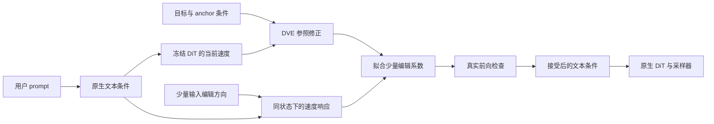

# 输入可实现的差分擦除：方法提案

## 1. 研究问题与核心选择

对 flow matching 训练的文生图 DiT，输入端编辑具有部署简单、结构依赖较弱的优势。但文本空间中的一个几何方向，不一定对应图像生成中的同一个语义变化。反过来，在输出速度场中构造的有效修正，也不一定能通过小幅文本修改实现。

本方案研究这两个空间之间的实际响应关系：**以速度场中的擦除修正为参照，测量候选输入修改的作用，选择当前状态下能实现该修正的输入组合。**

主版本冻结 DiT、文本编码器和 VAE，不训练分类器，不读取 attention、Q/K/V、中间层或独立文本分支。少量在线求解只拟合当前请求的几个编辑系数，不形成训练后的模型权重。

具体的研究对象是启用该推理模块时的概念抑制；关闭模块即可恢复原模型。论文表述应准确说明这个范围。

## 2. 为什么不直接采用另外几条路线

| 候选路线 | 优点 | 本轮不作为主方案的原因 |
| --- | --- | --- |
| 删除、替换概念词，附加安全描述 | 最便宜，完全在输入端 | 必须作为强基线；单独难以覆盖隐式描述，创新性有限 |
| 固定文本子空间投影 | 准备和推理成本低 | SAFREE、GrOCE 等已有近邻；文本正交不等于生成语义独立 |
| 直接把 Semantic Steering 的向量移到输入端 | 实现表面简单 | 内部激活空间与编码器输出空间不同，维数相同也不能视为同一坐标系 |
| 给 DVE 增加多个 anchor、子空间与门控 | 继续利用速度接口 | 容易堆积组件；DVE、CRG 等已覆盖部分动机，也偏离输入端偏好 |
| 微调文本编码器或训练小型条件映射器 | 可能有更强控制能力 | 需与 HiRM、DP、可学习 anchor 区分；先检验无训练编辑是否足够 |
| 根据速度响应选择输入修改 | 同时利用真实生成行为与输入端操作 | 是本轮建议验证的主线；主要风险是控制能力不足和在线成本 |

## 3. 只需要两个模型接口

**原生条件接口。** 将用户 prompt 编码为模型实际接收的条件包 `E`。它可以包含一个或多个 sequence embedding、pooled embedding、mask 和位置元数据。编辑只作用于浮点语义张量；保留 mask、位置、长度及结构性元数据的语义。

**速度评估接口。** 在给定 latent、采样位置与条件包后，获得该模型实际用于生成的条件速度。以 `f(x, s, E)` 表示，`s` 统一为从噪声到数据的生成进度。模型适配器负责原生 timestep、输出符号和 guidance 的对应。

这不是声称所有模型共用一份输入代码。它的含义是：无需为 single stream、double stream 或某个 block 的实现重新定义擦除算法。

对 FLUX 一类含蒸馏 guidance 的模型，应按实际 pipeline 求值；不能凭 CFG 公式假定存在真实的 unconditional 分支。对使用真实 CFG 的模型，每个比较必须复用相同的 unconditional 预测和 guidance 设置。研究结果同时报告原始条件输出与有效生成速度所用的定义。

## 4. 少量准备：构造原生输入编辑方向

### 4.1 成对文本，明确只改变什么

每个待擦除概念先准备 16–32 对短文本，每对具有相同上下文，只替换目标属性。人工模板即可，不要求外部 LLM、图片、分类标签模型或 VLM。

| 类型 | 目标文本 | 对照文本 | 主要保留意图 |
| --- | --- | --- | --- |
| 风格 | a landscape in the style of Van Gogh | a landscape painting | 场景、主体，减少指定作者风格 |
| 实体 | a church beside a road | a building beside a road | 保留场景与建筑用途层次；这是类替换策略 |
| 身份 | a portrait of a named person in a studio | a portrait of a person in a studio | 保留人物和场景，不额外指定种族、性别等属性 |
| 裸露属性 | an adult person without clothing in a studio | an adult person wearing clothing in a studio | 保留人物、姿态、环境，改变裸露属性 |

以上 anchor 是起点，不是已验证的最佳选择。尤其“church → building”不是删除整座建筑。对象任务需要事先区分“移除类别特征”和“移除整个对象”，两者不能用同一个指标混报。

### 4.2 每个原生条件通道单独计算

把两侧文本送入原模型的文本编码器。对 sequence 通道，利用模板中已知的替换片段，分别平均两侧对应片段的原生特征，再求“对照减目标”的差，并跨模板平均。不同 tokenizer 下分别定位片段，不逐位置硬减不等长序列。对 pooled 通道，直接使用成对 pooled 输出的差。

每个通道保留自己的方向与尺度，**不把不同编码器的向量拼成一个共同语义空间，也不把内部 DiT 向量反向搬过来**。

第一版每个通道只用一个方向。单通道模型若只得到一个有效方向，允许 `K=1`；多通道模型通常得到 `K=2–4` 个候选输入编辑。不要为了凑固定维数加入无依据的方向。

### 4.3 将方向变成当前 prompt 可用的编辑量

对 sequence 张量，将该通道方向广播到用户文本的可编辑 token 行；排除 padding、特殊控制 token 和模型自带 chat 模板的结构性片段。对 pooled 张量，在该张量上直接添加方向。每个编辑量记为 `A_j`，其形状与所作用的条件通道相同。

这里故意不要求在线定位“哪个词是目标概念”。因此没有显式目标词的 prompt 也会进入同一计算流程；能否成功处理隐式表达，仍取决于速度参照和编辑方向的覆盖能力。

这是一个非常简单的输入动作集合，也有明显弱点：广播可能扰动不相关 token，片段均值可能丢失上下文信息。把仅修改已知目标片段作为显式提示上的对照，不把它做成主方法必需的识别模块。

方向按各自通道的原生特征 RMS 尺度归一化；sequence 使用每个可编辑 token 的 RMS，不以序列总长度放大修改预算。校准时记录归一化方式和方向范数。测试不同长度 prompt 时，这些尺度固定。

仅用文本编码器构造方向不需要 DiT 前向。选择扰动幅度、正则和预算时若查询了 DiT，这部分另计准备成本。

## 5. 推理：三步核心计算

在第一个生成步和一个较早的后续检查点进行校准，例如生成进度约 0 与 0.3。检查点对应实际采样进度，不是把各模型原始 timestep 数值直接等同。中间步骤复用已确定的条件修改。

当前条件 `E_cur` 是已接受编辑后的条件；初次等于用户原生条件 `E_0`。所有分支使用同一个当前 latent 和采样位置，不另采不同噪声或先生成对照图。

### 第一步：取得 DVE 参照修正

复用当前用户条件的速度 `f_cur`，另计算目标概念和安全 anchor 的条件速度，按 DVE 的选择性纠正规则得到目标速度 `f_ref`。定义 `δ_DVE = f_ref − f_cur`。

此处的 DVE 是**参照目标**：主方法不会直接把 `f_ref` 交给采样器。若 DVE 判定无需修正，则该检查点不再试探输入，保留当前条件；这可以节约查询，但不能消除 DVE 门控的漏检。

第一轮研究沿用 DVE 的门控，目的是隔离“修改位置”这个变量。不要把门控换成新分数后，又把全部收益归因于输入端。DVE 的投影分数也不是经过校准的概念概率。

### 第二步：测量几个输入动作会怎样改变速度

对每个候选动作做一次小幅、单侧的实际前向。其单位输入响应是：

\[
R_j = \frac{f(x,s,E_{cur}+\epsilon A_j)-f(x,s,E_{cur})}{\epsilon}.
\tag{1}
\]

这里仅测有限个方向，不构造完整 Jacobian，不做全采样轨迹反向传播。`ε` 由小校准集预先选定，使输出差高于数值误差、输入修改仍在预算内。混合精度下需特别检查“差值几乎为零”是否只是精度损失。

### 第三步：选择能实现参照修正的小幅输入修改

以这些真实响应为列，求一个只有 `K` 个未知数的带约束拟合：

\[
a^*=\arg\min_{a\in\mathcal B}
\left\|\sum_j a_j R_j-\delta_{DVE}\right\|_2^2
+\lambda\|a\|_2^2.
\tag{2}
\]

`B` 同时限制这次更新的幅度和累计条件修改的每通道 RMS。第一版各方向仅允许沿“目标到对照”的方向增加；后续检查点也不能超出累计预算。更一般的可减弱更新不属于第一版。

这是通用的小规模带约束最小二乘，不宣称为新的数学理论。若使用非负或 box 约束，必须用相应求解器；不能把无约束解简单裁剪后声称得到了约束问题的精确解。可以直接通过各响应的内积形成 `K×K` 系统，避免显式展开巨大的矩阵。

候选条件与真正使用的速度为：

\[
E_{new}=E_{cur}+\sum_j a_j^*A_j,
\qquad f_{new}=f(x,s,E_{new}).
\tag{3}
\]

必须用这次**真实非线性前向**检查效果。将 `f_new` 与同一状态下的 `f_ref` 比较；相对于不修改条件的 `f_cur`，只有参照残差下降、累计输入预算满足时才接受。这只是速度拟合检查，不是安全判定或画质保证。

通过检查后，将 `f_new` 用作本步速度，并在后续步复用 `E_new`。第一次失败可以用一半更新量额外验证一次；仍失败就保留已有条件，记录输入修正失败。主版本不偷偷切回 DVE 输出纠正，否则输入方案的能力边界会被混合策略掩盖。

后续检查点围绕已编辑条件重新测量，只拟合额外的局部修正。因此“门控已关闭”时不会自动移除此前的条件编辑。累计不减弱的策略可能留下过度修改，这也是需要报告的限制。

## 6. 流程图与伪代码



```text
prepare(concept, anchor):
    用原生编码器处理少量目标/对照文本
    分通道构造并归一化输入编辑方向
    缓存目标与 anchor 的条件包

generate(prompt, seed):
    E0 = native_encode(prompt)
    E = E0
    x = native_noise(seed)
    for native sampling step:
        f_cur = native_effective_velocity(x, step, E)
        f_use = f_cur
        if step 是预先指定的检查点:
            f_ref = DVE_reference(x, step, f_cur, target, anchor)
            if f_ref 与 f_cur 存在需要纠正的差异:
                对每个可编辑方向测量一次局部速度响应
                求满足本次及累计预算的小规模约束拟合
                对候选条件做一次真实速度评估
                if 预算满足且相对 f_ref 的残差降低:
                    E = 候选条件
                    f_use = 已评估的候选速度
                else:
                    最多再验证一次减半更新
                    若仍失败，保留原 E、原 f_use，记录失败
        x = native_scheduler_step(x, f_use, step)
    return native_vae_decode(x)
```

原生 scheduler 的历史状态只接收最终选定的这一次速度；试探分支不推进或改写它。首先使用一阶采样器验证方法，避免将多步求解器的历史变化与输入编辑效果混为一谈。

## 7. 为什么这个目标可能兼顾保留，又为什么可能失败

拟合的目标是一个完整速度修正，而不只是增加“安全 anchor 相似度”。因此，某个输入动作即使沿擦除方向有效，只要同时带来很大的其他速度变化，也会产生较大的拟合误差。小幅输入预算进一步限制条件漂移。

这提供一个合理动机：在有限输入动作可产生的修正中，挑选接近目标的动作，可能少于直接输出修正带来的语义副作用。

需要区分“复现 DVE”与“改善 DVE”：在相同初始噪声和确定性采样器下，如果每一步都精确实现 DVE 的完整速度，轨迹与最终图像也会相同。此时收益只能来自计算方式或干预接口。若要声称保留能力更好，必须证明输入约束对参照修正的取舍有益，并在匹配擦除强度后比较；速度拟合成功本身不能证明这一点。

但“经过原模型前向得到”不能推出“位于正确图像流形”；输入也可能离开训练分布。全局速度 L2 还可能掩盖一个小区域内的身份、商标或裸露属性。局部检查通过也不能推出未来所有采样步或最终图像都安全。

因此本方法不依赖以下强假设：文本概念线性可分、不同概念天然正交、RF 学到的所有轨迹精确为直线、一次测量的方向全程不变。只把局部可拟合程度与跨步复用长度作为可测量的经验量。

## 8. 与重点两篇论文的实质关系

| 问题 | Semantic Steering | DVE | IRDE 提案 |
| --- | --- | --- | --- |
| 最终修改对象 | 选定 DiT block 的内部文本 token 激活 | 模型输出速度 | 原生文本条件张量 |
| 差分来自哪里 | 内部目标/安全表示 | 同状态目标/anchor 速度 | 编码器成对方向 + 当前输入动作的实测速度响应 |
| 对结构的要求 | 需定位与编辑内部文本表示 | 能访问输出速度 | 能编辑条件并访问输出速度 |
| 在线动作 | 多层注入缓存向量 | 逐步纠正或使用成本缩减变体 | 少量检查点测量、拟合和验证，其余步复用条件 |
| 本轮继承的部分 | 成对语义差的动机 | 参照修正及门控 | 不将这两部分重新声称为原创 |

核心候选贡献是**在输入可实现的操作集合中重建差分擦除，而不是把几种已有分数相加**。它是否足以支撑论文，取决于保留、迁移与成本实验，不能靠更换术语确认。

## 9. 计算成本必须这样算

设总采样步数为 `S`，有 `m` 个实际触发编辑的检查点，每点 `K` 个输入方向。在每步一次有效前向的设置中：

- 基础采样需要 `S` 次前向。
- 每个触发检查点额外需要两个概念分支、`K` 个试探分支和一个候选验证分支，即 `K+3` 次。
- 如果试探减半更新，再多一次前向；最多每个触发检查点一次。
- 仅做门控但不触发编辑的检查点仍需两个概念分支，不能按零成本计算。

例如 `S=28, K=2, m=2`，若两个检查点都触发、无需减半，合计 38 次前向，是基础模型的约 1.36 倍前向数；`K=4` 时为 42 次，约 1.50 倍。这个算术不是实测延迟。

完整逐步在线 DVE 在相同单概念设置中是 84 次；只纠正前 8 步是 44 次。**缓存版 DVE 在线接近基础前向数，Semantic Steering 的向量注入也很便宜。IRDE 不能笼统声称比 DVE 或现有无训练方法更快。**

对于真实 CFG，基础模型可能每步需要两个条件分支；可复用的 unconditional 分支应共享，逐个记录新增的 conditional 前向。批处理试探可能减少延迟，但不能隐藏总计算量和显存峰值。

对于 4–8 步蒸馏模型，这些查询可能过于昂贵，应单独报告，不作为第一轮效率论证的对象。离线准备另记文本编码次数、校准查询和方向缓存大小，不把准备时间从总成本中删除。

## 10. 可选的少量训练版本

只有无训练版本验证有效、但在线查询成为主要瓶颈时，再考虑把测得的编辑系数或条件修改拟合为一个很小的条件适配器。

这时需要保留样本、目标/对照样本和原模型速度作为监督，并报告训练集规模、DiT 前向/反向次数及显存。冻结 DiT 权重不意味着不需要穿过 DiT 对输入求梯度；少量可训练参数也不意味着低训练成本。

该版本应另命名为少量训练变体，不能继续混在严格无训练结果中，也不把它作为本轮主方案成功的前提。

## 11. 现阶段最重要的失败情形

1. **参照判断错。** DVE 没检测到目标，或把相近良性概念当成目标；本方法继承该误差。
2. **输入不可控。** 候选方向的速度响应无法覆盖所需修正；只能报告残差，不能用更大幅度掩盖。
3. **局部近似失效。** 多个方向合用与各自响应相加不一致；真实前向检查会发现一部分，不能发现全部。
4. **时间依赖强。** 两个检查点不足，目标在后期重新出现；若必须每步重拟合，应重新评估方案价值。
5. **编辑预算与保留冲突。** 目标抑制只在明显破坏姿态、场景或近邻类别时发生。
6. **anchor 代替了擦除。** 例如把所有风格都强推到同一种画风，检测率虽下降，生成多样性却塌缩。
7. **少步模型的查询成本过高。** 前向次数优势不能从 28 步模型直接外推。

以上均由 [实验方案](EXPERIMENTS.zh-CN.md) 区分检测，并与对应基线比较。
