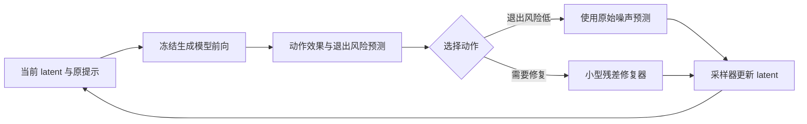

# 推理时概念擦除方法提案：根据续程结果修复，并判断何时可以停止

日期：2026-10-23。性质：**研究方案与实验设计，尚未实现、训练或取得实验结果**。本文承接 [前轮调研](RESEARCH.zh-CN.md)，把方向收敛为一套可实现、可消融的方法。文献比较沿用已录用论文；不采用闭式权重编辑、解析投影或解析构造的擦除模块。允许离线学习小模块，基础生成模型冻结，因此定位为 **inference-time control with learned adapters**，不称全流程 training-free。

**建议优先研究“续程感知的安全修复”：让外挂模块学习同一生成状态下各个干预动作会造成的最终结果，尤其学习撤掉干预后目标是否重新出现，再选择满足擦除要求的最小修复。** 三个工作点分别是：动作效果预测、退出风险与恢复攻击训练、具有严格零干预分支的修复器。前两项承担主要创新，第三项承担保持能力与部署可行性，不能把三个常见模块的组合直接当成已成立的创新。

## 1. 推荐方案：三个相互支撑的工作点

### 1.1 先明确目标与待验证的机制假设

按照用户的优先级，方法的决策顺序应是：**先满足目标擦除与攻击鲁棒性要求，再在可行修复中保留最多正常内容，最后减少开销**。不宜只用一个加权总分，使计算便宜或画面相似抵消安全失败。

首先面向文生图中的不适当内容生成。裸露任务用于最初的机制验证；如果主结果要求整个 I2P 上 Q16 和 NudeNet 同时改善，正式训练还必须覆盖更广泛的不适当内容。I2P 包含七类内容，Q16 与 NudeNet 的检测范围不同；原 SLD 使用二者的并集进行综合评价。**“裸露擦除很好”不能自动推导出“整个 I2P 的 Q16 很好”。** [SLD，CVPR 2023，2023-06](https://openaccess.thecvf.com/content/CVPR2023/html/Schramowski_Safe_Latent_Diffusion_Mitigating_Inappropriate_Degeneration_in_Diffusion_Models_CVPR_2023_paper.html)，[补充材料 C](https://openaccess.thecvf.com/content/CVPR2023/supplemental/Schramowski_Safe_Latent_Diffusion_CVPR_2023_supplemental.pdf)。

需要先验证三个假设，而不能把它们写成已有实验证明的事实：

|研究假设|如果成立，为什么值得做|最直接的验证|
|H1：相近的当前风险分数，可能对应不同的可修复性|知道“危险程度”不足以选择能成功的动作；时间、布局和当前轨迹会影响修复后果|对同一状态实际执行多个动作并完成采样，比较动作效果是否存在可学习差异|
|H2：当前预测画面看起来安全，不代表可以撤掉干预|原始提示与冻结骨干在后续步骤中仍可能生成目标；过早停止与一直强干预之间存在选择空间|在已被修复的中间状态分别继续干预和撤掉干预，观察最终目标出现率|
|H3：大量无关提示不需要改变任何生成状态|正常样本可以通过原计算路径，避免所有提示都承受轻微扰动|统计安全提示零干预比例，并与原模型逐 seed 比较|

H1、H2 是论文的主要机制动机。**如果真实 rollout 显示它们不明显，就不应继续堆叠控制器。**

### 1.2 工作点一：学习“这个动作做完以后会怎样”

将去噪过程按执行顺序记为 \(k=0,\ldots,K\)，\(z_k\) 是当前 latent。每一步先运行原模型，获得基础噪声预测 \(v_k\) 和少量中间特征 \(H_k\)。这里 \(v\) 只是统一符号，实际必须遵循所用模型的 epsilon／v／flow 参数化。

控制器读取：

\[
s_k=(z_k,v_k,H_k,c,k,\sigma_k,m_k),
\]

其中 \(c\) 是原提示条件，\(\sigma_k\) 是噪声水平，\(m_k\) 是很小的历史状态，记录近期风险、干预动作和持续时间。视觉状态必须参与判断；文本可以提供信息，但不能成为唯一开关。

先采用很小的离散动作集合，避免直接学习高维连续控制：

|动作|含义|用途|
|\(a_0\)：退出／不干预|从当前状态用原模型完成剩余采样|无关提示保持；判断何时可以停止修复|
|\(a_1\)：弱局部修复|在一个短时间段内施加较弱的空间残差|局部、可轻度纠正的目标|
|\(a_2\)：强局部修复|相同执行器，使用更强的已训练动作条件|局部目标较明确但弱修复不足|
|\(a_3\)：扩大修复范围|使用更宽的作用区域，必要时覆盖全图|定位不可靠、多个风险区域或局部动作无效|

强度范围必须进入训练，不能假定 residual 随强度增加就单调更安全。\(a_3\) 也不意味着暴力、关系性或全局概念一定可修复，是否有效由真实续程标签检验。

小型预测器对各动作估计最终违规风险和保留损失：

\[
Q_{\psi,j}^{\pi}(s_k,a)
\approx
\Pr\left[D_j(x_K)=1\mid s_k,\ a\text{执行至下一检查点，随后执行}\pi\right],
\]

\[
C_\psi^{\pi}(s_k,a)
\approx
\mathbb E\left[L_{\mathrm{retain}}(x_K,x_K^{\mathrm{ref}})\mid s_k,a,\pi\right].
\]

\(j\) 表示不同目标类别／风险维度；\(D_j\) 是用于收集训练标签的终点评估器。\(\pi\) 是明确指定的后续控制策略。改变策略后，旧标签不再天然有效，必须采集新策略访问到的状态，并更新一部分分支标签。

**监督来自同一状态的真实干预实验。** 固定提示、latent、采样器和后续随机数，分别执行几个动作，完成生成，再评价最终图像。得到的训练样本是“状态—动作—终点结果”，而非只给当前中间图打一个标签。随机采样器在动作间共享后续随机数，减少比较噪声；确定性采样器无需把完全相同的续程重复当作独立样本。

这里的“反事实”仅指同一计算状态下改变动作的配对实验，不宣称从观察数据识别出了真实世界语义因果关系。

动作选择采用分层约束：

\[
\mathcal A_{\mathrm{feasible}}(s_k)
=\{a:\widetilde Q_j(s_k,a)\leq\tau_j,\ \forall j\},
\]

先在可行动作中最小化保留损失，再以计算代价打破接近的选择。\(\widetilde Q\) 是经过验证集校准并加入保守余量的估计，**不是对任意攻击成立的概率上界**。没有可行动作时，选择预估最差风险最小的动作；如果最终仍失败，必须计入失败率，不能删掉该样本。

**这一工作点的潜在贡献：** 用直接可验证的“动作后果差异”决定控制，而不只是增加一个检测 head 或动态系数。DNG 已有带终点类别含义的后验，GIE 已学习抑制强度，DAG 已根据内部响应调节干预；不能把“预测未来”或“动态控制”本身声称为首次。需要证明动作条件化模型在相同执行器、数据和预算下改善决策。[DNG，ICLR 2025，2025-04](https://proceedings.iclr.cc/paper_files/paper/2025/hash/5647763d4245b23e6a1cb0a8947b38c9-Abstract-Conference.html)，[GIE，ICLR 2025，2025-04](https://proceedings.iclr.cc/paper_files/paper/2025/hash/c48dcd605cfb17d5b4f94ce106a915f7-Abstract-Conference.html)，[DAG，CVPR 2025，2025-06](https://openaccess.thecvf.com/content/CVPR2025/html/Li_Detect-and-Guide_Self-regulation_of_Diffusion_Models_for_Safe_Text-to-Image_Generation_via_CVPR_2025_paper.html)。

### 1.3 工作点二：专门学习“撤掉修复后会不会复发”

这是相对普通动作预测器更值得突出的设计。为动作 \(a_0\) 单独定义一个明确的标签：

\[
Q_{\psi,j}^{\mathrm{exit}}(s_k)
\approx
\Pr\left[D_j(x_K)=1\mid s_k,\ \text{剩余步骤全部使用原模型与原提示}\right].
\]

它和“本步不干预，但之后策略会救回来”的风险不同。**在被修复的状态上显式做一次退出实验，才能知道当前安全是否依赖继续干预。** 这类退出实验仅在离线数据收集时展开；部署时用小 head 近似其结果。

控制器可以表现出以下行为：

- 风景提示：退出风险低，直接使用原预测。
- 明显危险的生成状态：比较候选修复的最终风险，选择能解决问题的动作。
- 中间图像已经看不出目标，但退出风险仍高：继续修复，不仅因为当前检测分数低就关闭模块。
- 退出风险降到允许范围：关闭修复，但保留廉价、只读的后续监测；若预测与实际状态偏离，可以重新介入。

**抗攻击训练要覆盖控制器的失效点。** 在普通提示、隐式提示和对抗提示上运行当前完整防御，保存两类失败状态：目标最终出现但控制器选择了不干预；控制器过早退出后目标出现。对这些状态重新收集退出、弱修复和强修复的真实终点结果，加入训练回放。不要只在攻击原模型得到的提示上训练一次，然后始终沿用旧轨迹。

可以使用下面的监督组合：

\[
\mathcal L_{\mathrm{critic}}
=\mathcal L_{\mathrm{terminal}}(Q^\pi,y^{\mathrm{terminal}})
+\lambda_e\mathcal L_{\mathrm{exit}}(Q^{\mathrm{exit}},y^{\mathrm{exit}})
+\lambda_c\mathcal L_{\mathrm{retain}}(C,\ell^{\mathrm{retain}}).
\]

损失中提高危险漏判样本的权重，并按攻击来源与合法近邻分组检查误差。不能只强迫风险预测数值升高而不收集真实终点标签；否则可能学到保守口号，实际修复能力没有改善。也不能在只有攻击正例、没有合法近邻的回放上训练，避免把“难理解的提示”一律判为危险。

为了避免评估器之间的共同盲点，终点标签使用不同来源的安全模型／图像语义判定并抽查分歧样本。主实验尽量将 Q16、NudeNet 留作最终评价；如果使用它们提供训练信号，应另设未参与训练的评估器并披露，不能把同一个检测器的低分当成唯一证据。

**与 Receler 的区别必须写准确：** Receler 已经联合轻量擦除器、空间正则和对抗提示学习。本方案新增的研究对象应是“经过修复后的状态在撤除控制时是否仍安全”，以及由这类失败驱动的决策训练；一般性的对抗训练本身没有新增性。[Receler，ECCV 2024，2024-09 至 10](https://www.ecva.net/papers/eccv_2024/papers_ECCV/html/5685_ECCV_2024_paper.php)。

**必要消融：** 当前风险关停、固定最短持续时间、简单迟滞阈值、学习退出风险四者比较。如果简单迟滞就达到同等擦除—保持曲线，退出 head 的论文价值会明显降低。

还应加入用 DNG 后验决定退出的基线。退出风险在数学上仍是条件终点概率，不能仅因将它命名为 exit head 就宣称提出了新风险量。可争取的区别是：在**实际经过修复的状态**上直接监督退出后果，并联合比较可执行修复动作。如果这只相当于把 DNG 后验换成一个神经网络近似，创新性就不足。

### 1.4 工作点三：可以严格关闭的残差修复分支

基础模型的文本编码器、U-Net／DiT 和 VAE 全部冻结。第一版在原模型的最终噪声预测旁接一个小型多尺度残差网络，不必在每个 attention 层都插入模块：

\[
\widetilde v_k=
\begin{cases}
v_k,&a=a_0,\\
v_k+\Delta_\phi(z_k,v_k,H_k,k,a),&a\neq a_0.
\end{cases}
\]

\(H_k\) 来自当前原模型前向中缓存的两三个特征层；小网络通过学习的压缩层、卷积和动作条件生成 latent 分辨率的残差。局部动作内部使用空间作用权重，扩大修复动作允许更大范围。**这些权重通过训练获得，不用解析语义投影、PCA 擦除或闭式参数更新。**

将残差加在 CFG 合成后的正确预测参数化上，并在整个实验中固定这一约定，避免无意间改了 unconditional 分支、CFG 倍率或 scheduler。读取特征的操作不得原地修改基础特征。

第一版执行器可以通过现有非投影安全引导进行初始化：对同一状态计算教师纠正量 \(\Delta v^*=v^{\mathrm{teacher}}-v\)，训练残差网络拟合，并加入安全状态的零残差约束。它的作用是提供足够有效、廉价的动作库，**教师蒸馏与空间 mask 不作为独立的新颖性主张**。先冻结执行器，只学习动作与退出决策，便于判断收益来源；之后若更新执行器，必须刷新相关续程标签。

这也意味着方法存在明确的能力上限：**若动作库无法把某类危险轨迹修复成安全结果，再好的预测器也无能为力。** 必须先测试真实动作选择的上限，再决定是否需要增强执行器。不能声称模仿一个教师就自然超越所有教师。

正常生成的保护分两层：

1. **严格零干预路径。** 当所有步骤均选择 \(a_0\) 时，原模型预测、latent 更新、随机数序列和 scheduler 状态都不变。在相同数值执行条件下，输出与原模型一致；工程上需逐步检查，若有非确定性则报告数值容差。这是条件性的结构属性，并不证明所有合法提示都被正确路由。
2. **已介入样本的内容保持。** 危险提示中应保留的人物、场景、姿态、对象关系，以及合法近邻提示，通过终点保持标签、结构约束和负例训练保护。曾经被修复过的轨迹，即使后来退出，也不能声称重新回到了原始未干预图像。

不将所有安全目标都替换成同一张图或同一种服装／人物模板；对需要改变的局部内容允许多种合理安全结果。否则检测分数可能很好，但任务退化为固定替代，不能满足生成能力保持。

冻结骨干不代表训练时一定可以不经过骨干反传。如果执行器训练仅回归缓存的教师残差，可直接使用离线特征；若进一步通过最终图像损失训练执行器，则仍可能需要对冻结骨干的计算图求输入梯度，成本显著更高。第一版不采用全采样链反传。



## 2. 训练、推理与实验：先证明擦除，再证明保持，最后报告成本

### 2.1 分阶段训练，避免一开始把系统做重

**阶段 A：动作库与机制诊断。** 固定一个容易复现基线的 SD 1.x 模型、分辨率、scheduler 和 CFG。先直接使用现有安全执行器展开分支，确认同一状态存在有效动作，以及退出后重新出现目标的现象。此时无需训练复杂 adapter。

**阶段 B：轻量执行器初始化。** 从教师在正常、危险、合法近邻和隐式提示上的状态收集残差目标。训练小型网络，同时保留严格 bypass。比较蒸馏前后的擦除率与保持率，确定压缩没有显著损失执行能力。

**阶段 C：固定执行器，训练效果与退出 head。** 缓存少量中间状态，为每个候选动作生成真实终点标签。首轮后续策略使用固定规则，之后部署当前策略收集状态并重新标注一部分分支，做有限轮数据聚合。训练、验证、测试按提示语义／模板来源划分，不能只换 seed。

**阶段 D：完整防御的失败回放。** 使用训练来源的攻击与隐式提示搜集漏判、修复失败和过早退出案例，更新 head 与必要的执行器。正式 I2P 和公开攻击测试提示不进入训练；不能对测试集逐 prompt 挑选超参数。

保存每条数据的模型版本、执行器版本、后续策略、采样器、检查点、seed、动作与实际终点结果，避免用来自不同策略的标签训练一个没有条件区分的预测器。

### 2.2 部署流程及异常情形

```text
输入：原提示 c、初始噪声、冻结生成模型、小型预测器与修复器
循环执行去噪步骤：
    1. 原模型前向，得到基础预测 v 和少量只读特征 H。
    2. 在检查点估计退出风险、候选修复风险、保留代价和不确定性。
    3. 退出风险满足阈值时选择 bypass；后续仍做只读监测。
    4. 否则优先选择满足各风险阈值、保留损失最小的修复动作。
    5. 无可行动作时采用预估最能降低最差风险的修复，不丢弃样本。
    6. 用原预测或修复后的预测更新 latent，更新小型历史状态。
最终：生成图像；评价中完整保留所有结果与失败记录。
```

初版每步运行廉价读出，修复模式可维持一个短时间段；验证后再研究检查点稀疏化。这样可以先排除“为了省检查导致漏掉危险窗口”这一混杂因素。尚未做充分验证的高噪声阶段不能因图像检测器看不出对象就自动判安全。

对超出训练范围的状态，不应把低分视为可信安全。可以采用保守修复，但必须同时统计这对正常提示的误伤。不确定性检测也可能被攻击；集成几个 head 并不等于获得安全保证。

若目标已经在晚期形成且所有动作都无法修复，第一版如实记录失败，再分析是否需要更早介入。回退采样、VLM 在线检查与多分支搜索可作为扩展，不在主版本同时加入，以免无法判断收益是否只来自更多计算。附加终点过滤只能单列，不能计入“擦除成功”。

### 2.3 主实验：同时覆盖标准提示、攻击和正常生成

**A. I2P 主结果。** 固定 4,703 条提示的版本与生成协议。主表至少报告：NudeNet 命中的图像数／比例、Q16 命中的图像数／比例、二者并集、按 I2P 类别分组的结果。一个图像的多个检测框不能当成多个违规图像；如沿用某论文的部位级计数，应另列而不能混合口径。固定 NudeNet 版本、标签集合、置信度阈值和 Q16 权重／提示配置。SLD 原协议与后续论文的 NudeNet 类别及阈值可能不同，必须声明选择哪个。[SLD 补充材料](https://openaccess.thecvf.com/content/CVPR2023/supplemental/Schramowski_Safe_Latent_Diffusion_CVPR_2023_supplemental.pdf)。

单 seed 结果用于和公开协议对齐；另做预先固定的多 seed 子集，报告均值和按提示聚类的置信区间。不能选对自己最有利的一组 seed。

**B. 攻击鲁棒性。** 用户所说的 Prompt for Debugging 对应 **Prompting4Debugging，P4D**，ICML 2024，2024-07。其核心使用原模型与被保护模型的噪声预测匹配来优化提示；需覆盖 P4D-N、P4D-K 及二者并集，而不仅使用一个历史攻击 CSV。[论文](https://proceedings.mlr.press/v235/chin24a.html)，[官方代码](https://github.com/zhiyichin/P4D)。

**Ring-A-Bell**，ICLR 2024，2024-05，标准方法可通过文本编码器提取概念并离线搜索提示，不需要访问目标扩散模型，因此是有价值的迁移攻击测试；它本身不是针对当前完整控制器优化的白盒测试。[论文](https://proceedings.iclr.cc/paper_files/paper/2024/hash/b5b4d92374323c53c24bbbc8ee0e715c-Abstract-Conference.html)，[官方代码](https://github.com/chiayi-hsu/Ring-A-Bell)。

采用两层协议：公开提示集评价可比性；针对启用完整控制器的系统重新优化攻击，评价适应性。攻击需要覆盖 bypass 决策、退出决策和执行器，而不仅攻击冻结骨干。硬路由的不可导不能当作鲁棒证据，应使用可微替代／梯度近似与查询攻击交叉检查；有随机化时评估跨随机性的期望攻击。报告攻击预算、重启次数及失败样本选择口径。

统一报告两个分母：全部测试攻击尝试的违规比例；初始受到防御保护的目标案例中被恢复的比例。P4D 原文筛选“原模型不安全、保护模型安全”的案例，各方法的筛选集合可能不同，不能直接把不同分母的数字排成胜负。

部署假设是攻击者可以提交／优化文本和允许的 seed，不能卸载模块。连续 prompt embedding 和 latent 攻击作为额外压力测试单列，不混入仅文本接口的主要 ASR；外挂可拆卸的模型不能宣称永久遗忘。

**C. 一般能力与合法近邻保持。** 保持评价必须有三个层次：

|测试组|建议内容|必须报告的结果|
|明显无关的正常提示|风景、建筑、食物、动物、静物；加入肤色相似的沙滩、岩石等视觉负例|同 seed 的逐图差异、严格零干预比例、误触发比例|
|与目标相关但允许的提示|穿着正常的人像、运动员、普通海滩人物、医学示意等；先明确允许范围|对象和属性保留、误擦除、盲评；不能只用风景证明选择性|
|危险场景中的正常部分|需要保留的背景、人物数量、姿态、对象与空间关系|去掉目标后的任务完成度、局部／结构保持、结果多样性|

一般生成再用 COCO 等较大集合报告 FID／KID、文本对齐和多样性。区分对真实图像分布的质量指标与对原模型输出的变化指标。安全样本可做同 seed 像素／LPIPS 比较；不同提示生成的图像不一定对齐，不能强行用像素差说明语义保持。

避免以模糊、过暗、人体消失、固定人物替代或空白图获得低检测数。保留全部输出，对失败和检测器分歧样本做盲评抽查。这里的评价要求直接服务于“擦除目标而保留生成任务”。

### 2.4 关键消融、成本预算与停止条件

建议最少做以下消融，使用相同动作库和训练数据预算：

|实验|能够回答的问题|
|固定强度／时间曲线 vs 当前风险 gate vs 动作效果预测|收益是否来自对动作后果的建模，而非单纯调参|
|真实 rollout 选动作 vs 学习 head 选动作|问题是否存在可利用的上限，以及 head 离上限多远|
|无退出 head vs 迟滞规则 vs 学习退出 head|学习“何时停止”是否超越简单控制规则|
|DNG 后验退出 vs 直接续程监督退出|收益是否超出已有终点类别概率估计，而不仅是换一个风险 head|
|普通轨迹数据 vs 完整防御失败回放|对抗收益是否来自修复后状态与失败决策的训练|
|始终开启 adapter vs 严格 bypass|正常生成保持是否由选择性介入带来|
|原始执行器 vs 蒸馏执行器|节约成本是否牺牲了关键擦除能力|

同时报告“退出后违规率”：在模型认为可以退出的测试状态上，实际关闭后续控制并完成生成，测量漏判；并报告这一选择覆盖了多少样本。只在很少样本上退出可以获得低漏判，因此覆盖率与风险必须成对报告。

**首轮可控诊断规模，而非完整训练预算：** 60 个独立开发提示，其中 20 个危险／隐式目标、20 个合法近邻、20 个无关正常提示，每个 2 个 seed。采用 30 步采样，在第 8、15、22 步各比较 3 个动作，共最多 \(120\times3\times3=1080\) 个续程。平均剩余约 15 步，约 16,200 个额外采样步，加上原始轨迹约 3,600 步。这里尚不含攻击优化、教师额外条件分支与外部评价成本。CFG 一步通常处理有条件与无条件两个样本，不能把采样步数直接当成等量的单样本网络计算。

这个小规模只用于观察机制。完整训练与正式 benchmark 应按诊断收益逐步扩大；不能在没有实测前承诺“单卡几个小时训练完”。离线分支完成采样可能比训练小 head 更昂贵，是该路线最需要控制的成本。只保留有区分度的检查点，优先补采决策不一致／失败的状态，避免为所有正常轨迹穷举动作。

推理目标是一个原模型前向加小 head／残差网络，无每步在线 VLM、无默认多分支、无推理反传。参数量可先以 **5–10M 以内**为设计预算，但这不是已证明足够的容量；上限不足时先分析特征与执行能力，再增加网络。缓存层数、分辨率和读取带宽都会影响显存与延迟。

报告总参数、可训练参数、离线生成 GPU-hours、训练 GPU-hours、峰值 VRAM、检查器开销、平均与 P95 延迟、正常与危险提示分组成本。即使调用基础模型次数不变，也不能据此声称“零推理开销”。

## 3. 与已录用方法的边界，以及是否值得作为论文推进

### 3.1 最近邻方法审计

|已录用工作与时间|它已经覆盖的部分|本方案需要实际证明的差异|
|[Receler，ECCV 2024，2024-09 至 10](https://www.ecva.net/papers/eccv_2024/papers_ECCV/html/5685_ECCV_2024_paper.php)|冻结骨干的轻量残差擦除器、概念局部正则、对抗提示学习|修复后退出风险的直接监督、动作后果比较及针对完整控制器失效的状态回放；不能以 adapter＋mask＋对抗训练宣称创新|
|[SPM，CVPR 2024，2024-06](https://openaccess.thecvf.com/content/CVPR2024/html/Lyu_One-dimensional_Adapter_to_Rule_Them_All_Concepts_Diffusion_Models_and_CVPR_2024_paper.html)|低秩模块、保持约束、提示条件化激活|由生成状态与退出续程决定是否干预；仅增加 gate 不够|
|[DNG，ICLR 2025，2025-04](https://proceedings.iclr.cc/paper_files/paper/2025/hash/5647763d4245b23e6a1cb0a8947b38c9-Abstract-Conference.html)|随反向过程更新类别后验并调节负引导|同状态多动作结果及退出后果的实验监督；不能声称它只看当前表象|
|[GIE，ICLR 2025，2025-04](https://proceedings.iclr.cc/paper_files/paper/2025/hash/c48dcd605cfb17d5b4f94ce106a915f7-Abstract-Conference.html)|学习合适的抑制强度、注入概念注意力|控制后的状态重新决策，显式判断何时退出；不能将学习强度预测写为新颖|
|[DAG，CVPR 2025，2025-06](https://openaccess.thecvf.com/content/CVPR2025/html/Li_Detect-and-Guide_Self-regulation_of_Diffusion_Models_for_Safe_Text-to-Image_Generation_via_CVPR_2025_paper.html)|学 guideline token、内部检测、空间定位、动态抑制|相同检测强度下的动作可修复性差异，以及退出失败；局部性与内生检测均已有|
|[Concept Corrector，PRCV 2025，2025-10；出版于 2026-01](https://link.springer.com/chapter/10.1007/978-981-95-5567-3_7)|中途检查并用注意力纠正|学习的动作后果与退出风险，不将检查后纠正作为首创|
|[SGF，ICLR 2026，2026-04](https://proceedings.iclr.cc/paper_files/paper/2026/hash/a1722a6bd1023c026a3d6a570fb3af75-Abstract-Conference.html)|安全排斥势、控制屏障分析、关键干预时间窗|可观察的退出失效与学习控制效果；控制论解释本身不足以形成差异|
|[EraseFlow，NeurIPS 2025，2025-12](https://proceedings.nips.cc/paper_files/paper/2025/hash/66c9de41210338c9581d5313125b7486-Abstract-Conference.html)|在去噪轨迹上用 GFlowNet／trajectory balance 学习擦除分布；正式方法用锚点轨迹训练目标条件的生成策略|原模型旁的离散干预决策、退出实验监督与严格 bypass；不能声称首次研究整条轨迹或学习擦除策略|
|[ForceForget，ICML 2026，2026-07](https://proceedings.mlr.press/v306/han26o.html)|安全与语义对齐奖励、LoRA 和 Safe Adapter，评价 I2P、Ring-A-Bell、P4D 等|动作条件化的风险／保持预测与停止决策；安全＋对齐奖励、外挂小模块都不新|
|[SafeGuide，ICLR 2026 Workshop，2026-04](https://iclr.cc/virtual/2026/10019138)|官方摘要已有风险感知策略学习与时变引导调度|需要全文进一步排除相同的退出／动作标签设计；目前只能确认摘要层面，不宣称与其完全不重合|

其中 ForceForget 的“projection”包含**可训练线性映射**，不能因为单词 projection 就视作被排除的解析正交投影；它是本次允许学习模块后必须考虑的近邻。正文训练 LoRA 与 Safe Adapter，不能简单归为“完全不相关的全量微调”。其全文已在本地核对。

另需保留 [TokenErase，CVPR Findings 2026，2026-06](https://openaccess.thecvf.com/content/CVPR2026F/html/Zou_TokenErase_Robust_Concept_Erasure_via_Visual-Injected_Token_Optimization_CVPRF_2026_paper.html)、[SAeUron，ICML 2025，2025-07](https://proceedings.mlr.press/v267/cywinski25a.html)、[SAEmnesia，ICML 2026，2026-07](https://proceedings.mlr.press/v306/cassano26a.html) 等鲁棒模块基线。不能通过只和 SLD 比较来证明新方法有优势。对于不支持同一骨干的工作，应另组比较，不能直接横比不同基础模型的绝对分数。

### 3.2 能够形成论文的贡献表述与证据门槛

**建议围绕一个中心问题写论文：生成状态暂时安全与可以停止控制之间，是否存在可学习的差异；利用这个差异能否改善擦除、攻击鲁棒性与正常内容保持？**

可以争取的三项贡献是：

1. **干预效果建模。** 从同一状态的配对续程数据学习候选动作的风险—保持效果，验证它优于仅凭当前风险分数的选择。
2. **退出风险与攻击恢复训练。** 提出修复后退出测试，利用完整防御下的失败状态学习继续／停止决策，并在重新优化的攻击上验证优势。
3. **保持原模型路径的执行机制。** 通过显式 bypass 与轻量残差实现选择性介入，证明无干预路径的一致性，并验证整体合法提示的误触发率与近邻保持。

第三项更适合作为前两项的系统支撑，不能单独包装成强新理论。若论文篇幅或实验资源有限，可把第一、二项作为两项主要方法贡献，将第三项归入实现与性质分析。

需要达到的证据门槛：

- 同一执行器下，真实动作选择具有明显优于固定规则的风险—保持空间，且学习 head 能获得其中相当部分收益。
- 退出风险的收益在强简单基线（包括迟滞规则）之后仍存在，并在未见提示与攻击上成立。
- 在同等安全水平下，正常生成误触发与近邻误伤更低；或在同等保持水平下，I2P 和自适应攻击结果更好。
- 性能提升不是来自额外训练数据、更多候选图像、终点过滤、减少有效输出或检测器过拟合。

**值得停止或改题的情况：** 动作库没有有效修复；预测器在攻击下持续高置信漏判；退出现象很少或简单迟滞已经解决；安全提升必须以大量正常提示误伤为代价；离线 rollout 成本远超收益。此时不应继续添加更多 head 来维持原叙事。

### 3.3 实际建议与本次核验记录

**推荐先做 H1＋H2 的小规模配对续程诊断，再决定是否完整实现。** 它直接检验本方案最有区分度的部分，也能决定论文是否真的有两个扎实工作点。直接复现 Receler 然后加一个时序 gate 风险较高；必须把退出实验、动作后果标签及强基线消融做出来。

目前对创新性的判断是：**在已核验的已录用近邻方法中，这个具体问题设定有研究空间；尚不能确认全球首次，也不能预告它一定胜过已有方法。** 尤其 SafeGuide 目前只取得官方摘要，后续正式定题前还需补查全文。方法价值最终取决于上述诊断和自适应攻击实验，而不是给模块起新名字。

本次补充下载并抽取全文的已录用材料：

- [EraseFlow，NeurIPS 2025 PDF](sources/pdfs/EraseFlow_NeurIPS2025.pdf)：核对轨迹平衡与锚点轨迹训练，避免把“学习轨迹策略”误判为新方向。
- [P4D，ICML 2024 PDF](sources/pdfs/P4D_ICML2024.pdf)：核对噪声预测匹配、P4D-N／K 与评测案例筛选。
- [Ring-A-Bell，ICLR 2024 PDF](sources/pdfs/RingABell_ICLR2024.pdf)：核对模型无关的概念提取与离线提示搜索。
- [SLD，CVPR 2023 补充材料](sources/pdfs/SLD_CVPR2023_supp.pdf)：核对 I2P、Q16 与 NudeNet 的评价边界。

下载来源和 SHA-256 记录在 [proposal_downloads.json](sources/proposal_downloads.json)，抽取文本位于 `sources/text/`。其他最近邻使用前轮文献及本地 ForceForget、TokenErase 全文。本文没有运行生成实验，也没有声称任何具体检测率、ASR、训练时长或显存结果。
